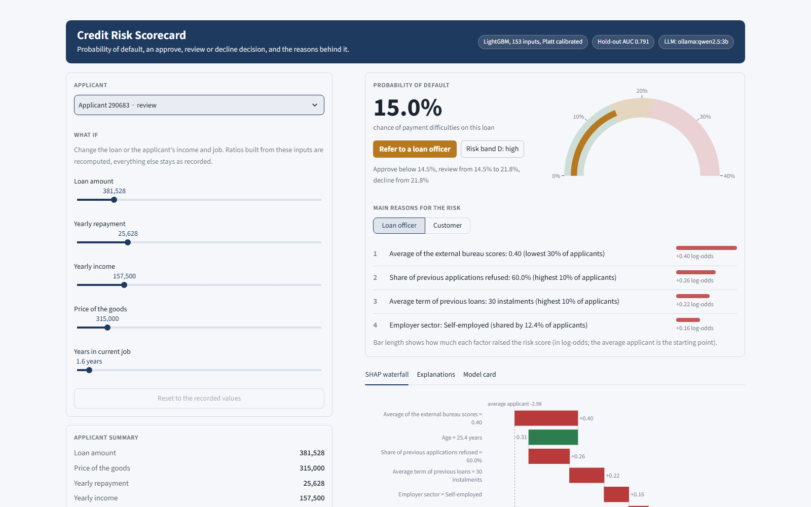
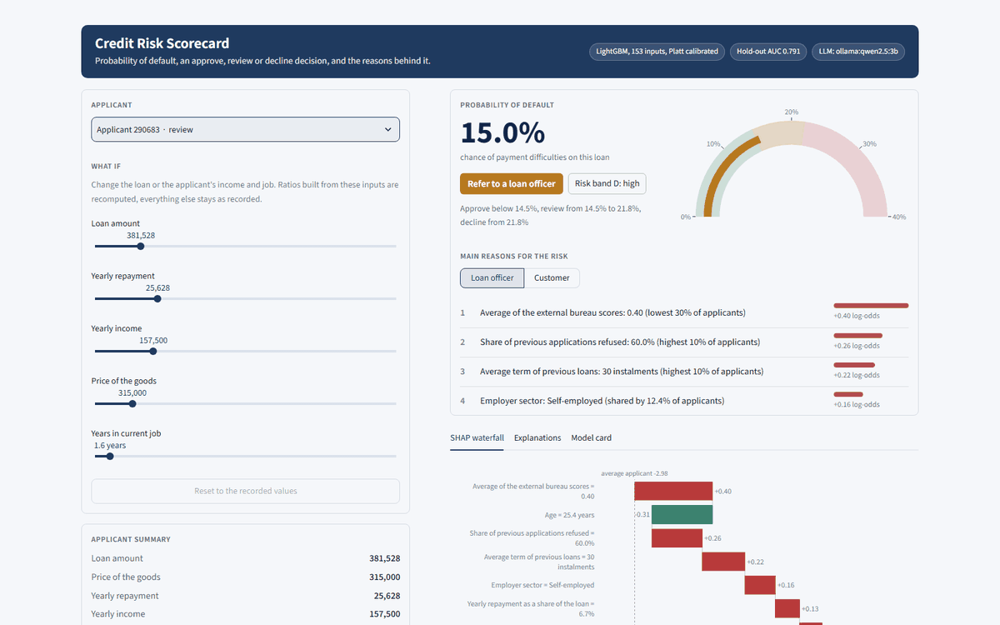
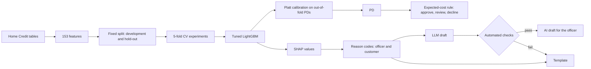

# Credit Risk Scorecard

[](https://github.com/Lagatorase/credit-risk-scorecard/actions/workflows/tests.yml)

An explainable probability of default (PD) model for consumer loans, built on the Home Credit Default Risk data. It turns each PD into an approve, review or decline decision using expected cost, and explains every score with reason codes for the loan officer and the customer. It also checks how the model treats gender and age groups, and tests whether a small local LLM can write the explanations safely.

The main part of this project is the evaluation. Every modelling choice was compared with 5-fold cross-validation on a fixed development set, and the hold-out set was used once, for the final model. The fairness and explanation checks report what didn't work as plainly as what did.





*Lowering one applicant's loan amount in the what-if panel, in real time. The ratio features are recomputed from the new amount and the PD, decision and reasons update.*

## What it does

- Builds 153 features from the application and five history tables: credit bureau, previous applications, instalments, POS/cash loans and credit cards.
- Compares a logistic WoE scorecard with LightGBM, with and without tuning, class weights and calibration, all under the same 5-fold CV.
- Calibrates the final model with Platt scaling fitted on out-of-fold predictions, so the PDs are real probabilities.
- Sets the approve/decline threshold from expected cost (LGD and margin), with a manual review band around the break-even PD.
- Explains every score with reason codes from SHAP values: the applicant's value and where it sits among other applicants, in separate officer and customer wording.
- Measures approval rates, default rates and calibration by gender, age band and marital status, with confidence intervals and comparison models.
- Writes a short explanation with a local LLM (qwen2.5:3b in Ollama), checks it automatically, and falls back to a template when a check fails.
- Serves everything through a FastAPI service and a Streamlit demo with what-if sliders.

## Key findings

All numbers are from real runs. CV numbers are means over five folds (fold standard deviation of AUC about 0.001); hold-out intervals are 95% bootstrap CIs.

- **The final model is accurate and well calibrated on the hold-out set.** AUC 0.7908 (0.7843 to 0.7976), Gini 0.582 and KS 0.440, in line with its CV AUC of 0.7885. Calibration slope 1.008 (0.979 to 1.038) and intercept 0.002 (-0.029 to 0.029) both include the ideal values, and ECE is 0.0015.
- **More data beat more tuning.** The five history tables lifted CV AUC from 0.7605 (application only) to 0.7802, and Optuna tuning added 0.008 more (to 0.7882) at about 8 minutes per fold against 4.5 seconds, while balanced class weights moved AUC by +0.0003 (noise) but raised ECE from 0.004 to 0.298.
- **Leaving gender out doesn't make the model blind to it.** The model's own inputs predict gender with AUC 0.904. It approves 80.3% of men and 87.0% of women. Part of that gap follows real default rates (10.2% against 7.0%), but it persists among applicants who repaid (84.3% against 89.4%). Adding gender back didn't help: AUC +0.0006 (-0.0010 to +0.0023), with a gender approval gap 2.2 points wider.
- **Removing age would hurt young applicants.** Without age, AUC changes by -0.0010 (-0.0024 to +0.0006), within noise. The age approval gap widens by 3.6 points (+2.5 to +4.8), and under-25s' approval rate falls from 70.3% to 66.7%. The model stays calibrated within 0.6 points in every age band.
- **The small LLM is good enough for officers, not for customers.** On 50 new hold-out applicants with frozen prompts and checks, officer drafts passed every check 80% of the time, and my manual read of the 40 accepted officer texts found 1 misstatement. Customer drafts passed only 50% of the time, mostly by dropping a reason's value, and 5 of the 25 accepted customer texts misread a reason (for example "instalments still to pay on 25 open loans" when the reason was 25 instalments). The text also isn't reproducible: at temperature 0 with a fixed seed, 18 of 100 texts still changed between two development runs.
- **The scorecard is a readable challenger.** The logistic WoE scorecard uses 17 features read off a points table and reaches a CV AUC of 0.7395, about 0.05 below LightGBM, with the lowest ECE of any model (0.0024).

## How it works



## Design decisions

**One fixed split, CV for every comparison.** `data/splits.json` holds an 80/20 stratified split made once. Every model comparison used the same five stratified folds on the development set (246,008 applicants), and anything learned from data (WoE bins, encodings, calibration) was fitted inside each training fold only. The hold-out set (61,503 applicants) was scored once, after the final model was chosen.

**No class weights.** Balanced class weights left AUC unchanged but pushed the predicted PDs far above the real default rates. The expected-cost decision needs a PD that is a real probability, so every model after that experiment is unweighted.

**Platt scaling, fitted out of fold.** Platt and isotonic calibration were within fold noise of each other. I chose Platt because isotonic regression is a step function: it gives whole blocks of applicants the same PD, and those ties pile up at the decision threshold. The calibrator only ever sees out-of-fold scores, because in-sample scores are overconfident.

**Threshold from cost, not from a target approval rate.** With an assumed LGD of 45% and a 10% margin lost on a declined good applicant, approving is cheaper below a PD of 0.10 / (0.45 + 0.10) = 18.2%. Applicants within 2% of the loan amount of break-even (PD 14.5% to 21.8%) go to manual review. These costs are assumptions in `config/decision.yaml`, not bank figures, and the report shows how the approval rate moves if the margin changes.

**Gender and marital status left out.** `CODE_GENDER` and `NAME_FAMILY_STATUS` are not model inputs. A comparison model with them added back showed no measurable accuracy gain and a wider gender approval gap, so leaving them out costs nothing. This follows the MAS FEAT principle that personal attributes used in a decision should be justified.

**Age kept in, but officer-only.** A model without age was no more accurate, and it was less fair to young applicants. The other inputs identify under-25s with an AUC of 0.993, so removing age doesn't stop the model sorting by age. It only makes the sorting less accurate: under-25s' approval rate fell from 70.3% to 66.7%. Age stays in the model, but it can appear in a loan officer's reasons and never in a customer's.

**Location and contact details are officer-only too.** Region ratings, address mismatches, social circle defaults and contact or document flags can appear in the officer's reasons but never in the customer's. Location features carry a fair-lending risk (they can stand in for protected groups), and telling a customer their region counted against them would be hard to justify.

**Reason codes state facts, not judgements.** Each reason gives the applicant's value and where it sits among development applicants ("Share of previous applications refused: 60.0% (highest 10% of applicants)"). Category reasons say how common the answer is ("shared by 12.4% of applicants") so they can't be misread as a percentile. Opaque bureau scores show the customer only the percentile, since a raw 0.40 means nothing to them. At most one reason per family is shown, so four reasons don't all describe the same bureau score.

**The LLM drafts, the code decides.** The code writes the opening sentence that states the decision, and the LLM writes the rest from the reason codes. Eight automated checks run on every draft: decision, numbers, factors, protected terms, officer-only terms, coverage, judgement words and format. A draft that fails any check is replaced by a template, and the result records which one was used. There is no retry: in development, a retry with the failures quoted back fixed none of them.

**Customers get the template by default.** The officer sees the LLM draft, labelled "AI-drafted summary: check against the reason codes", with the reason codes next to it. The customer gets the template, because in my manual read 5 of 25 accepted customer drafts misstated a reason. `CUSTOMER_EXPLANATION=llm` turns the LLM option on.

## Results

### Model comparison (5-fold CV on the development set)

| Experiment | Inputs | AUC | Gini | KS | Brier | ECE |
|---|---|---|---|---|---|---|
| Scorecard (WoE logistic), application | 81 (17 kept) | 0.7395 ± 0.0013 | 0.4790 | 0.3585 | 0.06916 | 0.0024 |
| LightGBM, application | 81 | 0.7605 ± 0.0008 | 0.5209 | 0.3900 | 0.06782 | 0.0031 |
| LightGBM, + bureau | 105 | 0.7666 ± 0.0016 | 0.5332 | 0.3994 | 0.06743 | 0.0041 |
| LightGBM, all tables | 153 | 0.7802 ± 0.0008 | 0.5603 | 0.4219 | 0.06652 | 0.0040 |
| LightGBM, all, balanced weights | 153 | 0.7805 ± 0.0014 | 0.5609 | 0.4234 | 0.17650 | 0.2979 |
| LightGBM, all, tuned | 153 | 0.7882 ± 0.0012 | 0.5764 | 0.4370 | 0.06597 | 0.0040 |
| LightGBM, all, tuned + Platt | 153 | 0.7882 ± 0.0012 | 0.5764 | 0.4370 | 0.06595 | 0.0036 |

Full detail: [`reports/experiment_report.md`](reports/experiment_report.md).

### Final model on the hold-out set

| Metric | Hold-out | 95% CI | Development, out of fold |
|---|---|---|---|
| AUC | 0.7908 | 0.7843 to 0.7976 | 0.7885 |
| Gini | 0.5815 | 0.5686 to 0.5953 | 0.5770 |
| KS | 0.4403 | 0.4294 to 0.4549 | 0.4350 |
| Brier | 0.06536 | 0.06396 to 0.06691 | 0.06597 |
| Calibration slope (ideal 1) | 1.0077 | 0.9787 to 1.0381 | 0.9994 |
| PSI of the PD | 0.0004 | | stable |

The PSI only confirms the split is consistent: the data has no application dates, so there's no out-of-time test. Full detail: [`reports/holdout_report.md`](reports/holdout_report.md).

### Decision rule (hold-out set)

The cost-based rule works because the PDs are calibrated. On the hold-out set it approves 84.7% of applicants, and 4.8% of them default, against 8.1% overall. Applicants sent to review default at 17.7% and declines at 34.0%. The cost curve is flat near break-even: 2.80%, 2.78% and 2.81% of the amount applied for at thresholds of 14.5%, 18.2% and 21.8%.

| Decision | Applicants | Share | Mean PD | Actual default rate |
|---|---|---|---|---|
| approve | 52,088 | 84.7% | 4.8% | 4.8% |
| review | 4,484 | 7.3% | 17.8% | 17.7% |
| decline | 4,931 | 8.0% | 33.7% | 34.0% |

Full detail, including how the approval rate moves with the margin assumption: [`reports/threshold_report.md`](reports/threshold_report.md).

### Fairness (hold-out set)

| Group | Applicants | Actual default rate | Approval rate (95% CI) | Approval rate among those who repaid |
|---|---|---|---|---|
| Men | 20,940 | 10.2% | 80.3% (79.7 to 80.8) | 84.3% |
| Women | 40,561 | 7.0% | 87.0% (86.6 to 87.3) | 89.4% |

| Comparison model | AUC change (95% CI) | Approval gap change | Decisions that change |
|---|---|---|---|
| Gender and marital status added | +0.0006 (-0.0010 to +0.0023) | gender gap +2.2 points | 3,716 (6.0%) |
| Age removed | -0.0010 (-0.0024 to +0.0006) | age gap +3.6 points | 3,645 (5.9%) |

Full detail, including every age band and marital status: [`reports/fairness_report.md`](reports/fairness_report.md).

### LLM explanations (50 new hold-out applicants, qwen2.5:3b)

| | Officer | Customer (option, off by default) |
|---|---|---|
| All checks pass | 80% | 50% |
| Fell back to the template | 20% | 50% |
| Misstatements in accepted texts (manual read) | 1 of 40 | 5 of 25 |
| Median seconds per draft | 1.3 | 1.2 |

Full detail, the failure examples and the earlier tuning runs: [`reports/llm_eval.md`](reports/llm_eval.md).

## Setup (Windows)

You need Python 3.11 or newer, about 4 GB of free disk space for the data, and [Ollama](https://ollama.com) if you want the LLM explanations.

```powershell
git clone https://github.com/Lagatorase/credit-risk-scorecard
cd credit-risk-scorecard
python -m venv .venv
.venv\Scripts\activate
pip install -r requirements.txt

copy .env.example .env
ollama pull qwen2.5:3b
```

Without Ollama, set `LLM_BACKEND=none` in `.env` and every explanation uses the template.

### Get the data

The Home Credit data is not in this repo, because it belongs to Home Credit. Accept the competition rules on [Kaggle](https://www.kaggle.com/competitions/home-credit-default-risk), put your Kaggle API token in place, then:

```powershell
python scripts/download_data.py
python scripts/convert_to_parquet.py
```

You can also download the CSVs by hand into `data/raw`. The development/hold-out split is already in `data/splits.json`; don't regenerate it.

### Build the model and reports

```powershell
python scripts/build_features.py
python -m experiments.run_experiments          # 5-fold CV for every experiment (tuning takes about 40 minutes)
python -m experiments.make_report
python scripts/train_final.py
python scripts/evaluate_holdout.py
python scripts/build_reference.py
python scripts/choose_threshold.py
python scripts/explain_examples.py
python scripts/fairness.py
python scripts/fairness_age.py
python scripts/eval_explanations.py            # needs Ollama
python scripts/export_demo_applicants.py
```

On a 16 GB laptop, run these one at a time: the feature build and the fairness models each use several GB of memory.

### API and demo

```powershell
uvicorn api.main:app --reload            # API docs at http://localhost:8000/docs
streamlit run app/streamlit_app.py       # demo at http://localhost:8501
```

`POST /score` takes an applicant's model inputs and returns the PD, risk band, decision, both sets of reason codes and the explanations. `GET /health` and `GET /model-card` report the model's state and its [model card](docs/model_card.md).

Or run both with Docker (build the model on the host first, since the containers mount `models/`):

```powershell
docker compose up --build
```

The image build is tested in CI on every push. I haven't run the containers myself, since Docker isn't installed on my machine.

### Tests

```powershell
pytest -q
```

The tests don't need the Home Credit data or a trained model. They train a small model on made-up data, and run the whole feature pipeline on synthetic tables generated from [`tests/data/home_credit_schema.json`](tests/data/home_credit_schema.json). That file holds only derived summary statistics (column names, types, category levels, 1st and 99th percentiles and missing shares), with no rows, and is used only to generate the synthetic test data.

## Project layout

```
scorecard/     features, models, calibration, decision rule, reason codes, fairness, LLM explanations, scoring service
experiments/   CV experiment runner and report
scripts/       one script per pipeline step
api/           FastAPI service
app/           Streamlit demo
config/        decision rule, reason code wording, model inputs
reports/       every report and figure quoted above
tests/         unit tests, API tests and the end-to-end synthetic test
```

## Limitations

- **One lender's past approvals.** Outcomes exist only for applicants Home Credit lent to. Applicants it refused are missing, so the model learns from an already filtered population (reject inference isn't attempted).
- **No out-of-time test.** The data has no application dates, so the hold-out set is a random 20% of the same period. Real performance on later applicants would likely be lower.
- **Cost assumptions.** LGD, margin and the review band are my assumptions, not bank figures. The amounts' currency isn't stated in the data either.
- **Limited fairness checks.** The data records gender (as two values), age and marital status only. Race, religion and other protected attributes can't be checked, and the results are associations, not causes.
- **A small local LLM.** qwen2.5:3b misread some reasons that passed every automated check. A larger hosted model (the OpenAI and Anthropic backends are set up) might do better, but I haven't run it because it costs money.

## License

MIT. The Home Credit data is subject to the Kaggle competition rules and is not included.
