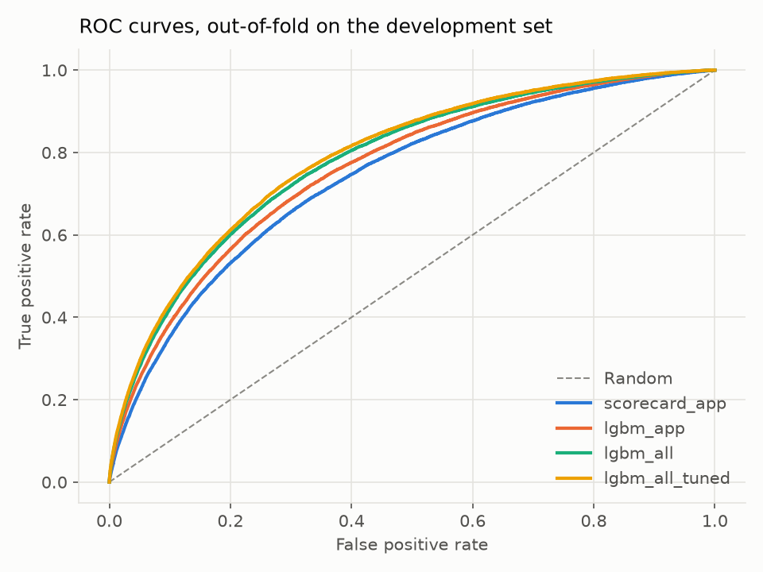
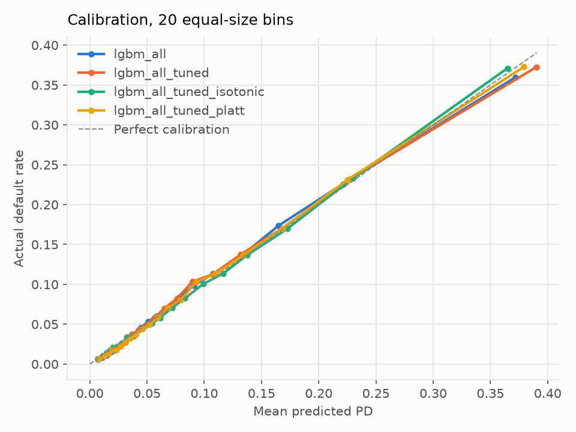
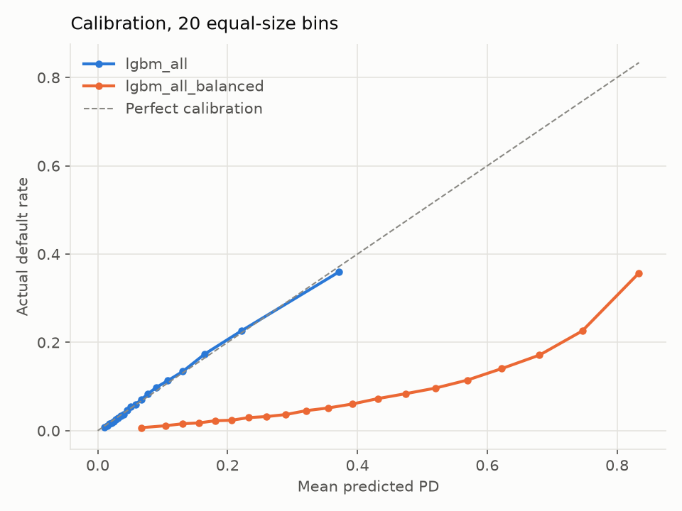
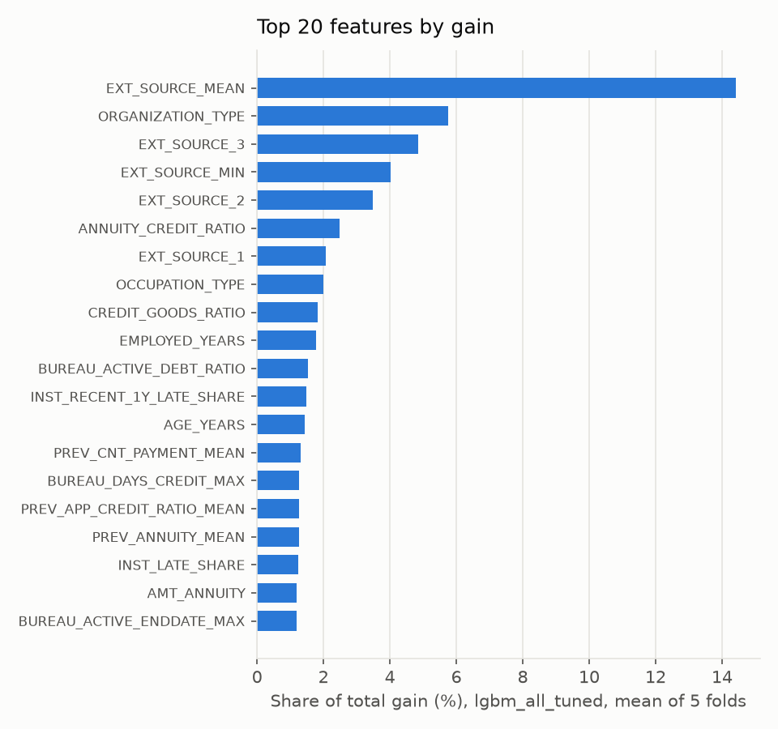

# Experiment report (2026-10-24)

5-fold stratified CV on the development set (246,008 applicants, default rate 8.07%). Each cell is the mean ± standard deviation across the five folds. The hold-out set is not used here.

## All experiments

| Experiment | Model | Features | Inputs | AUC | Gini | KS | PR-AUC | Brier | ECE | Fit time per fold (s) |
|---|---|---|---|---|---|---|---|---|---|---|
| scorecard_app | scorecard | app | 81 (17 kept) | 0.7395 ± 0.0013 | 0.4790 ± 0.0026 | 0.3585 ± 0.0043 | 0.2122 ± 0.0030 | 0.06916 ± 0.00010 | 0.0024 ± 0.0004 | 3.6 |
| lgbm_app | lgbm | app | 81 | 0.7605 ± 0.0008 | 0.5209 ± 0.0016 | 0.3900 ± 0.0028 | 0.2424 ± 0.0047 | 0.06782 ± 0.00015 | 0.0031 ± 0.0005 | 2.0 |
| lgbm_app_bureau | lgbm | app + bureau | 105 | 0.7666 ± 0.0016 | 0.5332 ± 0.0032 | 0.3994 ± 0.0057 | 0.2505 ± 0.0049 | 0.06743 ± 0.00018 | 0.0041 ± 0.0010 | 2.8 |
| lgbm_all | lgbm | all | 153 | 0.7802 ± 0.0008 | 0.5603 ± 0.0015 | 0.4219 ± 0.0028 | 0.2681 ± 0.0042 | 0.06652 ± 0.00019 | 0.0040 ± 0.0009 | 4.5 |
| lgbm_all_balanced | lgbm, balanced weights | all | 153 | 0.7805 ± 0.0014 | 0.5609 ± 0.0027 | 0.4234 ± 0.0034 | 0.2681 ± 0.0029 | 0.17650 ± 0.00090 | 0.2979 ± 0.0015 | 4.7 |
| lgbm_all_tuned | lgbm_tuned | all | 153 | 0.7882 ± 0.0012 | 0.5764 ± 0.0024 | 0.4370 ± 0.0015 | 0.2790 ± 0.0024 | 0.06597 ± 0.00009 | 0.0040 ± 0.0007 | 493.0 |
| lgbm_all_tuned_isotonic | lgbm_calibrated (isotonic) | all | 153 | 0.7880 ± 0.0011 | 0.5760 ± 0.0023 | 0.4357 ± 0.0013 | 0.2722 ± 0.0020 | 0.06596 ± 0.00008 | 0.0031 ± 0.0012 | 72.9 |
| lgbm_all_tuned_platt | lgbm_calibrated (platt) | all | 153 | 0.7882 ± 0.0012 | 0.5764 ± 0.0024 | 0.4370 ± 0.0015 | 0.2790 ± 0.0024 | 0.06595 ± 0.00009 | 0.0036 ± 0.0010 | 0.1 |

AUC, Gini, KS and PR-AUC measure ranking (higher is better). Brier and ECE measure calibration (lower is better). ECE uses 10 equal-frequency bins of predicted PD. Inputs is the number of features offered to the model; the scorecard keeps fewer after IV selection (below).

## Class weights (on lgbm_all)

| Metric | lgbm_all | lgbm_all_balanced | Change |
|---|---|---|---|
| AUC | 0.7802 | 0.7805 | +0.0003 |
| PR-AUC | 0.2681 | 0.2681 | +0.0000 |
| Brier | 0.06652 | 0.17650 | +0.10998 |
| ECE | 0.0040 | 0.2979 | +0.2939 |

## Calibration (on lgbm_all_tuned)

| Version | Brier | ECE | AUC |
|---|---|---|---|
| lgbm_all_tuned | 0.06597 ± 0.00009 | 0.0040 ± 0.0007 | 0.7882 ± 0.0012 |
| lgbm_all_tuned_isotonic | 0.06596 ± 0.00008 | 0.0031 ± 0.0012 | 0.7880 ± 0.0011 |
| lgbm_all_tuned_platt | 0.06595 ± 0.00009 | 0.0036 ± 0.0010 | 0.7882 ± 0.0012 |

Lowest ECE: lgbm_all_tuned_isotonic. Lowest Brier: lgbm_all_tuned_platt. The choice is explained in the notes below.

## Tuning

Optuna (TPE sampler) ran 30 trials inside each of the five training folds, maximising AUC on an inner 20% split with early stopping; the outer validation fold was never seen.

| Fold | Inner AUC | Trees | Learning rate | Leaves | Min child samples | Column sample | Tuning time (min) |
|---|---|---|---|---|---|---|---|
| 1 | 0.7885 | 1145 | 0.030 | 17 | 53 | 0.45 | 8.1 |
| 2 | 0.7902 | 1631 | 0.032 | 17 | 30 | 0.31 | 8.9 |
| 3 | 0.7871 | 928 | 0.046 | 27 | 101 | 0.40 | 7.6 |
| 4 | 0.7834 | 1094 | 0.036 | 25 | 174 | 0.41 | 7.6 |
| 5 | 0.7893 | 888 | 0.061 | 16 | 122 | 0.42 | 6.9 |

## Scorecard feature selection

Features kept per fold: 20, 17, 17, 17, 17. Kept in all 5 folds (17): `ANNUITY_CREDIT_RATIO`, `CREDIT_GOODS_RATIO`, `DAYS_ID_PUBLISH`, `DAYS_LAST_PHONE_CHANGE`, `DAYS_REGISTRATION`, `EMPLOYED_YEARS`, `EXT_SOURCE_1`, `EXT_SOURCE_3`, `EXT_SOURCE_MEAN`, `FLAG_DOCUMENT_3`, `FLOORSMAX_AVG`, `NAME_EDUCATION_TYPE`, `OCCUPATION_TYPE`, `ORGANIZATION_TYPE`, `OWN_CAR_AGE`, `REGION_RATING_CLIENT_W_CITY`, `REG_CITY_NOT_LIVE_CITY`.

The points table fitted on the whole development set is in [scorecard_points.md](scorecard_points.md).

## Figures

## What these results show

The fold-to-fold standard deviation of AUC is about 0.001, so differences below about 0.002 are noise.

- **The side tables were the biggest gain.** Bureau data added 0.006 AUC to the application-only LightGBM (0.7605 to 0.7666), and the previous applications, instalment, POS and credit card tables added another 0.014 (to 0.7802). Behavioural history mattered more than anything done to the model itself.
- **Tuning added less.** Optuna raised AUC by 0.008 (0.7802 to 0.7882) and KS by 0.015, by choosing more, shallower trees (900 to 1,600 trees, 16 to 27 leaves, learning rate 0.03 to 0.06). It cost about 8 minutes per fold against 4.5 seconds for the default model.
- **Class weights wrecked calibration without improving ranking.** Balanced weights left AUC and PR-AUC unchanged (0.7805 against 0.7802, 0.2681 against 0.2681), but the predicted PDs rose far above actual default rates: ECE went from 0.004 to 0.298 and Brier from 0.067 to 0.177. A PD that feeds an expected-cost decision has to be a real probability, so every later model is unweighted.
- **The scorecard trades about 0.05 AUC for full readability and good calibration.** It scores 0.7395 against 0.7882 for the tuned model, but uses 17 features whose points can be read off a table, and it had the lowest ECE of any model (0.0024). It is a fair challenger model, or the fallback if every decision must be traceable by hand.

## Calibration choice

Platt scaling and isotonic regression were within fold noise of each other and of the uncalibrated tuned model: ECE 0.0036 and 0.0031 against 0.0040, with fold standard deviations of about 0.001. I chose Platt. Isotonic regression is a step function, so it gives many applicants exactly the same PD. Those ties pile up at the decision threshold, where a whole block of applicants would be approved or declined together. Tied applicants with different reason codes would also get identical PDs, so their explanations would look inconsistent. Platt is a smooth monotonic curve that keeps the model's ranking exactly (same AUC, KS and PR-AUC), whereas isotonic's ties cost 0.007 PR-AUC.

## Timing note

The fit times for the two calibrated versions don't include tuning, which was cached from `lgbm_all_tuned` and reused on identical folds. The isotonic run includes the three extra boosters per fold that produce the calibration predictions. The Platt run reused those same boosters, which is why it shows 0.1 s.
