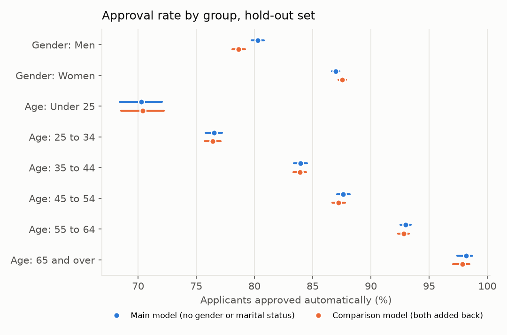
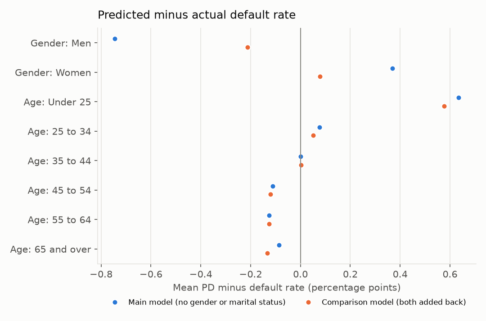
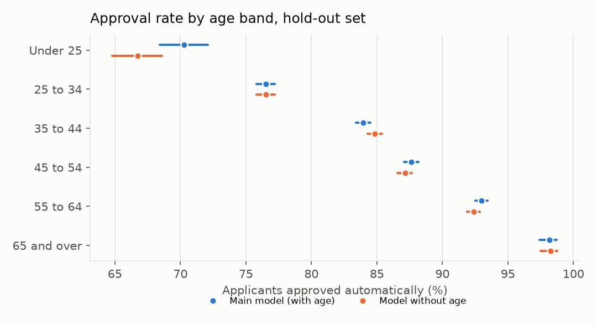

# Fairness and the protected attributes

All numbers are on the 61,503 hold-out applicants. Decisions use the rule from `config/decision.yaml`: approve below a PD of 14.5%, review from 14.5% to 21.8%, decline above. "Approved" means approved automatically, so applicants sent to review count as not approved. Intervals are 95%: Wilson intervals for the group rates, paired bootstrap (1,000 resamples) for the overall metrics and the gaps.

Definitions: **TPR** is the share of applicants who went on to default that the rule did not approve automatically (the defaulters it caught). **Approval rate among those who repaid** is the matching view for good applicants (equal opportunity). Two comparison models are trained with the final model's recipe (same parameters, Platt fit out of fold): one with `CODE_GENDER` and `NAME_FAMILY_STATUS` added back, and one without the age inputs. They are used for this report only.

## Summary

- **Leaving a column out doesn't make the model blind to it.** Gender is not a model input, yet a model given the main model's own 153 inputs predicts gender with a cross-validated AUC of 0.904. Under-25s are even easier to pick out without any age input: AUC 0.993. Excluding an attribute stops the model using it directly, but patterns that go with it are still in the data.
- **Gender:** the main model approves 80.3% of men and 87.0% of women. Adding gender and marital status back gives no measurable accuracy gain (AUC +0.0006, CI -0.0010 to +0.0023) and widens the gender approval gap by 2.2 points, so both stay out.
- **Age:** the largest gaps (70.3% of under-25s approved against 98.2% of over-65s) follow real differences in default rates, and the model is well calibrated in every age band. Removing age costs accuracy within noise (AUC -0.0010, CI -0.0024 to +0.0006) but widens the age approval gap by 3.6 points, with under-25s losing most. Age stays in the main model, for the loan officer only.

## What these results show

**Gender.** The main model approves 80.3% of men and 87.0% of women, a gap of 6.7 points. Most of that follows the outcomes in the data: 10.2% of men in the hold-out set defaulted against 7.0% of women. The gap doesn't fully disappear when only applicants who repaid are counted, though. Men who repaid were approved 84.3% of the time and women who repaid 89.4%, so a creditworthy man was less likely to get an automatic yes. The model doesn't know gender, so it can't fully separate the two groups. It slightly underestimates men's risk (mean PD 0.7 points below their actual default rate) and slightly overestimates women's (0.4 points above). Approved men still default more often than approved women (5.7% against 4.4%).

**Adding gender and marital status back** made no measurable difference to accuracy. Hold-out AUC rose by 0.0006 (95% CI -0.0010 to +0.0023), and every other overall metric changed by an amount whose interval includes zero. Gender still ranks second of 155 inputs by mean absolute SHAP value in the comparison model. The two facts fit together: the comparison model uses gender heavily, but gender adds little the other inputs didn't already carry. A separate model predicts gender from the main model's own inputs with an AUC of 0.904. What adding gender does change is how decisions split between groups. Within-group calibration improves (men -0.2 points, women +0.1). Men's approval rate falls from 80.3% to 78.6%, women's rises from 87.0% to 87.6%, and the approval gap widens by 2.2 points (CI +1.9 to +2.6). 3,716 applicants (6.0%) would get a different decision. Marital status follows the same pattern on a smaller scale: the approval gap widens by 1.8 points.

So there is a trade-off. Gender as an input makes each group's PD a little more accurate on average, but it widens the gap in who gets approved, and it doesn't improve the model's ranking of applicants. Since it buys no accuracy and is hard to justify as a reason to refuse credit, I kept both attributes out of the main model.

**Age** gives the largest gaps by far. 70.3% of under-25s are approved against 98.2% of applicants aged 65 and over, and among those who repaid, 74.4% against 98.4%. Age is an input to the main model, but the gaps aren't a calibration artefact. Mean PD is within 0.6 points of the actual default rate in every band, and actual default rates fall steadily with age, from 11.7% to 3.6%. Whether age may be used in a lending decision, and how much, is a policy and legal question for a lender, not something the model can settle. In this project age can appear in a loan officer's reasons but never in a customer's. The TPR for applicants aged 65 and over (8.5%, CI 3.7 to 18.4) rests on only 59 defaulters, so it is very uncertain.

**Removing age** (comparison 2) doesn't help the groups it might be meant to protect. Accuracy drops by an amount within noise (AUC -0.0010, CI -0.0024 to +0.0006), but the gaps between age bands get wider, not narrower. The approval gap widens by 3.6 points (CI +2.5 to +4.8), and so does the gap among applicants who repaid. Under-25s lose most: their approval rate falls from 70.3% to 66.7%, and among those who repaid from 74.4% to 70.9%. Without age, the model overestimates their risk by 1.7 points instead of 0.6. The other inputs still identify under-25s almost perfectly (AUC 0.993). Inputs such as employment length and how recently the ID document was issued are likely carriers, but I haven't checked which ones do the work. So the model still sorts by age; it just does so less accurately, and the error lands on the youngest applicants. 3,645 applicants (5.9%) would get a different decision. Since dropping age makes no measurable accuracy difference, removing it is a choice the lender could make, but on these numbers it would be a worse outcome for young applicants. I've kept age in the main model.

**Limits.** These are associations in one lender's historical data, and they can't establish why the groups differ. Differences in default rate may come from income, job type, loan product or many other things that differ between groups. They may also come from the past decisions themselves, since outcomes only exist for applicants Home Credit actually lent to, and the applicants it refused are missing from the data. Gender is recorded as two values, and the data holds no other protected attributes, such as race or religion, so those can't be checked. The fairness measures also pull against each other. When default rates differ between groups, a model can't be well calibrated within each group and also approve each group at the same rate, or approve creditworthy applicants in each group at the same rate. Choosing which gap to accept is a judgement for the lender, and the tables here are meant to make that choice visible, not to make it.

**MAS FEAT.** The Monetary Authority of Singapore's FEAT principles ask that AI-driven decisions do not systematically disadvantage groups without justification, that the use of personal attributes as inputs is justified, and that data and models are reviewed regularly for unintended bias. Leaving gender and marital status out, showing what they would change, measuring how much gender and age information remains in the other inputs, testing a model without age, and keeping age out of customer-facing reasons are this project's attempt at that. The analysis would need repeating on each new model version and on live decisions, not only on a historical hold-out set.

## Approval and default rates by group (main model)

### Gender

| Group | Applicants | Actual default rate | Approval rate | Default rate among approved | TPR | Approval rate among those who repaid |
|---|---|---|---|---|---|---|
| Men | 20,940 | 10.2% | 80.3% (79.7 to 80.8) | 5.7% (5.3 to 6.0) | 55.2% (53.1 to 57.3) | 84.3% (83.8 to 84.8) |
| Women | 40,561 | 7.0% | 87.0% (86.6 to 87.3) | 4.4% (4.2 to 4.6) | 45.6% (43.8 to 47.5) | 89.4% (89.1 to 89.7) |

### Age

| Group | Applicants | Actual default rate | Approval rate | Default rate among approved | TPR | Approval rate among those who repaid |
|---|---|---|---|---|---|---|
| Under 25 | 2,392 | 11.7% | 70.3% (68.4 to 72.1) | 6.5% (5.4 to 7.8) | 61.1% (55.2 to 66.6) | 74.4% (72.5 to 76.2) |
| 25 to 34 | 14,368 | 10.5% | 76.5% (75.8 to 77.2) | 5.6% (5.1 to 6.0) | 59.6% (57.1 to 62.1) | 80.8% (80.1 to 81.4) |
| 35 to 44 | 16,889 | 8.3% | 83.9% (83.4 to 84.5) | 4.9% (4.5 to 5.2) | 50.7% (48.1 to 53.3) | 87.1% (86.5 to 87.6) |
| 45 to 54 | 14,039 | 7.3% | 87.6% (87.1 to 88.2) | 4.5% (4.2 to 4.9) | 46.0% (43.0 to 49.1) | 90.3% (89.8 to 90.8) |
| 55 to 64 | 12,165 | 5.6% | 93.0% (92.5 to 93.4) | 4.2% (3.9 to 4.6) | 30.4% (27.1 to 34.0) | 94.4% (93.9 to 94.8) |
| 65 and over | 1,650 | 3.6% | 98.2% (97.4 to 98.7) | 3.3% (2.6 to 4.3) | 8.5% (3.7 to 18.4) | 98.4% (97.7 to 98.9) |

### Marital status

| Group | Applicants | Actual default rate | Approval rate | Default rate among approved | TPR | Approval rate among those who repaid |
|---|---|---|---|---|---|---|
| Civil marriage | 5,963 | 9.7% | 82.0% (81.0 to 82.9) | 5.7% (5.1 to 6.4) | 51.2% (47.1 to 55.3) | 85.5% (84.6 to 86.4) |
| Married | 39,279 | 7.7% | 85.3% (84.9 to 85.6) | 4.5% (4.3 to 4.7) | 49.8% (48.0 to 51.6) | 88.2% (87.8 to 88.5) |
| Separated | 3,930 | 9.0% | 85.7% (84.6 to 86.8) | 5.6% (4.9 to 6.4) | 46.8% (41.6 to 52.0) | 89.0% (87.9 to 89.9) |
| Single / not married | 9,085 | 9.3% | 81.2% (80.4 to 82.0) | 5.4% (4.9 to 5.9) | 52.7% (49.3 to 56.0) | 84.6% (83.8 to 85.4) |
| Widow | 3,246 | 5.6% | 91.4% (90.4 to 92.3) | 3.9% (3.3 to 4.7) | 36.6% (30.0 to 43.8) | 93.0% (92.1 to 93.9) |

2 hold-out applicants have no recorded gender (`XNA` in the raw data) and are left out of the gender rows. Groups under 30 applicants are left out of the gap calculations.

## Calibration within groups

A positive number means the model predicts more defaults than the group actually had.

| Group | Actual default rate | Main model mean PD | Main minus actual | With gender and marital status: mean PD | With gender and marital status: minus actual |
|---|---|---|---|---|---|
| Gender: Men | 10.2% | 9.4% | -0.7 pts | 10.0% | -0.2 pts |
| Gender: Women | 7.0% | 7.4% | +0.4 pts | 7.1% | +0.1 pts |
| Age: Under 25 | 11.7% | 12.3% | +0.6 pts | 12.3% | +0.6 pts |
| Age: 25 to 34 | 10.5% | 10.6% | +0.1 pts | 10.6% | +0.1 pts |
| Age: 35 to 44 | 8.3% | 8.3% | -0.0 pts | 8.3% | +0.0 pts |
| Age: 45 to 54 | 7.3% | 7.2% | -0.1 pts | 7.2% | -0.1 pts |
| Age: 55 to 64 | 5.6% | 5.5% | -0.1 pts | 5.5% | -0.1 pts |
| Age: 65 and over | 3.6% | 3.5% | -0.1 pts | 3.4% | -0.1 pts |
| Marital status: Civil marriage | 9.7% | 9.0% | -0.7 pts | 9.7% | +0.0 pts |
| Marital status: Married | 7.7% | 7.8% | +0.2 pts | 7.6% | -0.0 pts |
| Marital status: Separated | 9.0% | 7.8% | -1.2 pts | 8.0% | -1.0 pts |
| Marital status: Single / not married | 9.3% | 9.3% | +0.0 pts | 9.6% | +0.3 pts |
| Marital status: Widow | 5.6% | 6.2% | +0.6 pts | 5.9% | +0.3 pts |

## Comparison 1: adding gender and marital status back

### Overall performance (hold-out)

| Metric | Main model | With gender and marital status | Change (95% CI) | Development out of fold: main model, with gender and marital status |
|---|---|---|---|---|
| AUC | 0.7908 | 0.7914 | +0.0006 (-0.0010 to +0.0023) | 0.7885, 0.7898 |
| Gini | 0.5815 | 0.5827 | +0.0012 (-0.0020 to +0.0045) | 0.5770, 0.5797 |
| KS | 0.4403 | 0.4412 | +0.0008 (-0.0052 to +0.0072) | 0.4350, 0.4363 |
| PR-AUC | 0.2928 | 0.2944 | +0.0016 (-0.0021 to +0.0051) | 0.2782, 0.2826 |
| Brier | 0.06536 | 0.06530 | -0.00007 (-0.00021 to +0.00008) | 0.06597, 0.06580 |
| ECE | 0.0015 | 0.0017 | +0.0001 (-0.0017 to +0.0015) | 0.0028, 0.0025 |
| Calibration slope | 1.0077 | 1.0058 | -0.0019 (-0.0094 to +0.0057) | 0.9994, 0.9993 |
| Calibration intercept | 0.0015 | 0.0032 | +0.0017 (-0.0012 to +0.0044) | 0.0001, 0.0001 |

In this model `CODE_GENDER` ranks 2 and `NAME_FAMILY_STATUS` 17 of 155 inputs by mean absolute SHAP value (5,000 hold-out applicants).

### Decisions that change

| Main model \ With gender and marital status | Approve | Review | Decline |
|---|---|---|---|
| Approve | 50,883 | 1,173 | 32 |
| Review | 1,080 | 2,692 | 712 |
| Decline | 20 | 699 | 4,212 |

3,716 applicants (6.0%) get a different decision.

### Gaps between groups

The gap is the highest group's rate minus the lowest group's, in percentage points. The change column is comparison minus main; an interval that includes zero means the data can't tell the two models apart on that gap.

**Gender**

| Metric | Gap, main model | Gap, with gender and marital status | Change (95% CI) |
|---|---|---|---|
| Approval rate | 6.7 (6.1 to 7.3) | 8.9 (8.3 to 9.6) | +2.2 (+1.9 to +2.6) |
| Default rate among approved | 1.3 (0.9 to 1.7) | 1.2 (0.8 to 1.6) | -0.1 (-0.3 to +0.0) |
| TPR (defaulters not auto-approved) | 9.6 (6.9 to 12.3) | 11.8 (9.0 to 14.5) | +2.3 (+0.7 to +3.7) |
| Approval rate among those who repaid | 5.1 (4.5 to 5.7) | 7.3 (6.7 to 7.9) | +2.2 (+1.9 to +2.6) |
| Mean predicted PD | 2.1 (1.9 to 2.2) | 2.9 (2.7 to 3.1) | +0.8 (+0.8 to +0.9) |
| Actual default rate | 3.2 (2.7 to 3.6) | 3.2 (2.7 to 3.6) | +0.0 (+0.0 to +0.0) |

**Age**

| Metric | Gap, main model | Gap, with gender and marital status | Change (95% CI) |
|---|---|---|---|
| Approval rate | 27.9 (26.0 to 29.8) | 27.5 (25.6 to 29.4) | -0.4 (-1.5 to +0.8) |
| Default rate among approved | 3.2 (1.8 to 4.6) | 3.3 (2.0 to 4.7) | +0.2 (-0.4 to +0.8) |
| TPR (defaulters not auto-approved) | 52.6 (44.6 to 61.8) | 50.2 (42.3 to 60.3) | -2.4 (-6.9 to +2.0) |
| Approval rate among those who repaid | 24.0 (22.0 to 25.8) | 23.7 (21.8 to 25.7) | -0.3 (-1.5 to +0.9) |
| Mean predicted PD | 8.9 (8.4 to 9.3) | 8.8 (8.4 to 9.3) | -0.0 (-0.1 to +0.1) |
| Actual default rate | 8.1 (6.6 to 9.7) | 8.1 (6.6 to 9.7) | +0.0 (+0.0 to +0.0) |

**Marital status**

| Metric | Gap, main model | Gap, with gender and marital status | Change (95% CI) |
|---|---|---|---|
| Approval rate | 10.2 (9.0 to 11.4) | 12.0 (11.1 to 13.5) | +1.8 (+1.3 to +2.9) |
| Default rate among approved | 1.8 (1.2 to 2.9) | 1.6 (1.0 to 2.8) | -0.2 (-0.5 to +0.2) |
| TPR (defaulters not auto-approved) | 16.1 (8.8 to 24.3) | 18.0 (11.0 to 26.1) | +2.0 (-1.5 to +6.1) |
| Approval rate among those who repaid | 8.4 (7.3 to 9.5) | 10.2 (9.2 to 11.5) | +1.8 (+1.2 to +2.8) |
| Mean predicted PD | 3.1 (2.8 to 3.4) | 3.7 (3.4 to 4.1) | +0.7 (+0.5 to +1.0) |
| Actual default rate | 4.0 (3.0 to 5.1) | 4.0 (3.0 to 5.1) | +0.0 (+0.0 to +0.0) |

## Comparison 2: removing age

This model drops every input derived from `DAYS_BIRTH` (`AGE_YEARS`, `EMPLOYED_TO_AGE_RATIO`) and keeps the other 151 inputs.

### Overall performance (hold-out)

| Metric | Main model | Without age | Change (95% CI) | Development out of fold: main model, without age |
|---|---|---|---|---|
| AUC | 0.7908 | 0.7898 | -0.0010 (-0.0024 to +0.0006) | 0.7885, 0.7869 |
| Gini | 0.5815 | 0.5796 | -0.0019 (-0.0047 to +0.0012) | 0.5770, 0.5737 |
| KS | 0.4403 | 0.4374 | -0.0030 (-0.0096 to +0.0033) | 0.4350, 0.4318 |
| PR-AUC | 0.2928 | 0.2919 | -0.0009 (-0.0042 to +0.0028) | 0.2782, 0.2770 |
| Brier | 0.06536 | 0.06542 | +0.00006 (-0.00009 to +0.00019) | 0.06597, 0.06605 |
| ECE | 0.0015 | 0.0015 | +0.0000 (-0.0020 to +0.0014) | 0.0028, 0.0028 |
| Calibration slope | 1.0077 | 1.0150 | +0.0073 (+0.0002 to +0.0145) | 0.9994, 0.9995 |
| Calibration intercept | 0.0015 | 0.0028 | +0.0013 (-0.0014 to +0.0041) | 0.0001, 0.0001 |

### Approval rates by age band

| Age band | Applicants | Actual default rate | Approval rate: main | Approval rate: without age | Among those who repaid: main | Among those who repaid: without age | Mean PD minus actual: main | Mean PD minus actual: without age |
|---|---|---|---|---|---|---|---|---|
| Under 25 | 2,392 | 11.7% | 70.3% (68.4 to 72.1) | 66.7% (64.8 to 68.6) | 74.4% | 70.9% | +0.6 pts | +1.7 pts |
| 25 to 34 | 14,368 | 10.5% | 76.5% (75.8 to 77.2) | 76.5% (75.8 to 77.2) | 80.8% | 80.8% | +0.1 pts | +0.0 pts |
| 35 to 44 | 16,889 | 8.3% | 83.9% (83.4 to 84.5) | 84.9% (84.3 to 85.4) | 87.1% | 87.9% | -0.0 pts | -0.3 pts |
| 45 to 54 | 14,039 | 7.3% | 87.6% (87.1 to 88.2) | 87.1% (86.6 to 87.7) | 90.3% | 89.8% | -0.1 pts | -0.0 pts |
| 55 to 64 | 12,165 | 5.6% | 93.0% (92.5 to 93.4) | 92.4% (91.9 to 92.8) | 94.4% | 93.8% | -0.1 pts | +0.1 pts |
| 65 and over | 1,650 | 3.6% | 98.2% (97.4 to 98.7) | 98.2% (97.5 to 98.8) | 98.4% | 98.5% | -0.1 pts | -0.3 pts |

### Decisions that change

| Main model \ Without age | Approve | Review | Decline |
|---|---|---|---|
| Approve | 50,934 | 1,137 | 17 |
| Review | 1,054 | 2,746 | 684 |
| Decline | 24 | 729 | 4,178 |

3,645 applicants (5.9%) get a different decision.

### Gaps between age bands

| Metric | Gap, main model | Gap, without age | Change (95% CI) |
|---|---|---|---|
| Approval rate | 27.9 (26.0 to 29.8) | 31.5 (29.5 to 33.5) | +3.6 (+2.5 to +4.8) |
| Default rate among approved | 3.2 (1.8 to 4.6) | 2.9 (1.7 to 4.2) | -0.3 (-0.9 to +0.3) |
| TPR (defaulters not auto-approved) | 52.6 (44.6 to 61.8) | 56.2 (46.9 to 65.3) | +3.6 (-0.4 to +6.9) |
| Approval rate among those who repaid | 24.0 (22.0 to 25.8) | 27.6 (25.6 to 29.5) | +3.6 (+2.4 to +4.9) |
| Mean predicted PD | 8.9 (8.4 to 9.3) | 10.1 (9.7 to 10.6) | +1.3 (+1.1 to +1.4) |
| Actual default rate | 8.1 (6.6 to 9.7) | 8.1 (6.6 to 9.7) | +0.0 (+0.0 to +0.0) |

## Do the remaining inputs still identify the group?

A default LightGBM model is trained to predict the group from the other inputs, with 5-fold CV on the development set. An AUC of 0.5 means no information; 1.0 means the group can be read straight off the inputs.

| Group predicted | From | Cross-validated AUC |
|---|---|---|
| Men vs women | the main model's 153 inputs (gender and marital status left out) | 0.904 |
| Under 25 vs 25 and over | the 151 inputs of the model without age | 0.993 |

Leaving a column out of the inputs does not make the model blind to it.
