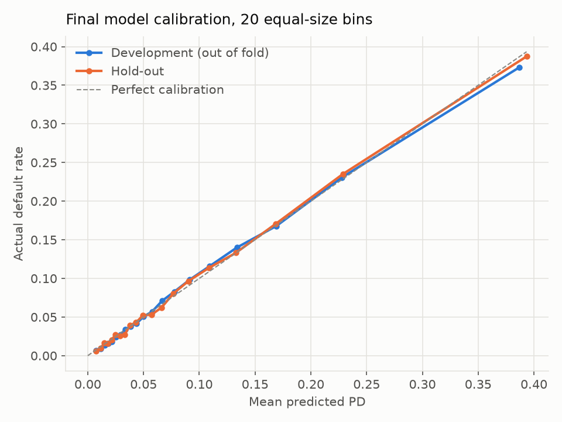
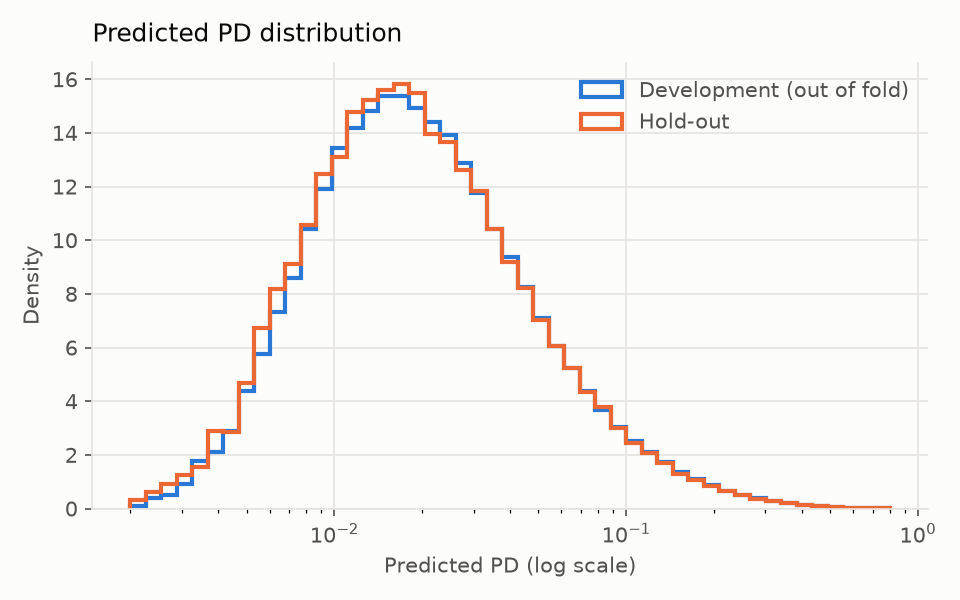

# Hold-out evaluation

The final model (LightGBM with the parameter set from fold 3, Platt calibration) was trained on all 246,008 development applicants and scored once on the 61,503 hold-out applicants (default rate 8.07%). Intervals are percentile bootstrap 95% CIs from 1,000 resamples of the hold-out set.

| Metric | Hold-out | 95% CI | Development, out of fold |
|---|---|---|---|
| AUC | 0.7908 | 0.7843 to 0.7976 | 0.7885 |
| Gini | 0.5815 | 0.5686 to 0.5953 | 0.5770 |
| KS | 0.4403 | 0.4294 to 0.4549 | 0.4350 |
| PR-AUC | 0.2928 | 0.2806 to 0.3069 | 0.2782 |
| Brier | 0.06536 | 0.06396 to 0.06691 | 0.06597 |
| ECE | 0.0015 | 0.0018 to 0.0045 | 0.0028 |

The development column scores each development applicant with the fold model that didn't see them, after Platt calibration. Across folds the AUC varied by ± 0.0016 (standard deviation), so the hold-out AUC is in line with cross-validation.

The ECE point estimate sits below its bootstrap interval. That isn't an error: ECE is biased upward by sampling noise (any random wobble in a bin counts as miscalibration), and each bootstrap resample adds more noise, so the resampled values run high. I read the interval as an upper range: hold-out calibration error is at most about half a percentage point.

## Choosing the final parameters

I didn't run a new search on the whole development set. Instead each of the five parameter sets Optuna found (one per training fold of `lgbm_all_tuned`) was cross-validated on the same five folds, and the set with the best mean CV AUC was kept: the one from fold 3.

| Parameter set from fold | CV AUC (mean ± std) | Inner AUC during tuning | Trees | Learning rate | Leaves |
|---|---|---|---|---|---|
| 1 | 0.7881 ± 0.0009 | 0.7885 | 1145 | 0.030 | 17 |
| 2 | 0.7880 ± 0.0013 | 0.7902 | 1631 | 0.032 | 17 |
| 3 (chosen) | 0.7885 ± 0.0016 | 0.7871 | 928 | 0.046 | 27 |
| 4 | 0.7885 ± 0.0009 | 0.7834 | 1094 | 0.036 | 25 |
| 5 | 0.7871 ± 0.0006 | 0.7893 | 888 | 0.061 | 16 |

All five sets are within 0.0014 AUC of each other, about the size of the fold-to-fold noise, so the choice matters little. The final model uses the chosen set with the tree count scaled by 1.25 (1160 trees), because the full development set has 25% more rows than a training fold. Platt scaling was fit on the chosen set's out-of-fold predictions (coefficient 0.976, intercept -0.028), never on in-sample scores.

## Stability (PSI, development against hold-out)

Reading: under 0.1 stable, 0.1 to 0.25 watch, over 0.25 shift. Development scores are the out-of-fold PDs, so both samples are scored by models that never saw them.

| Variable | PSI | Reading |
|---|---|---|
| Predicted PD | 0.0004 | stable |
| `EXT_SOURCE_MEAN` | 0.0002 | stable |
| `ORGANIZATION_TYPE` | 0.0008 | stable |
| `EXT_SOURCE_3` | 0.0003 | stable |
| `EXT_SOURCE_MIN` | 0.0002 | stable |
| `EXT_SOURCE_2` | 0.0001 | stable |
| `ANNUITY_CREDIT_RATIO` | 0.0003 | stable |
| `EXT_SOURCE_1` | 0.0003 | stable |
| `OCCUPATION_TYPE` | 0.0004 | stable |
| `EMPLOYED_YEARS` | 0.0002 | stable |
| `CREDIT_GOODS_RATIO` | 0.0001 | stable |

The hold-out set is a random 20% of the same applications, so a low PSI is expected. It confirms the split and the scoring pipeline are consistent, but it is not a test of drift over time: the dataset has no application dates, so I can't build an out-of-time sample.
