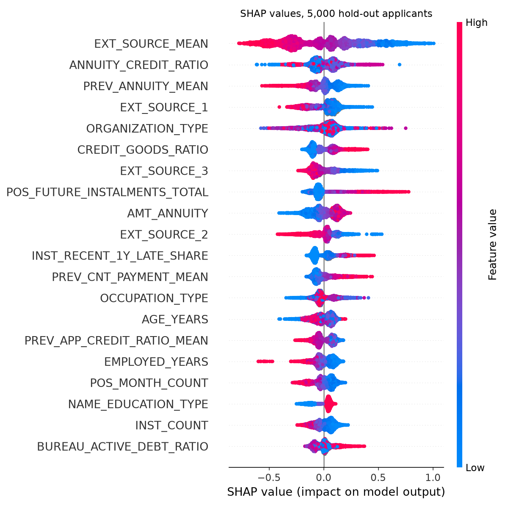

# Explainability and reason codes

SHAP values come from `shap.TreeExplainer` on the final LightGBM booster, in log-odds of default before calibration (Platt scaling is monotonic, so the direction of every factor is the same for the calibrated PD).

## Top 10 features by mean absolute SHAP value

| Feature | Mean abs SHAP |
|---|---|
| `EXT_SOURCE_MEAN` | 0.321 |
| `ANNUITY_CREDIT_RATIO` | 0.103 |
| `PREV_ANNUITY_MEAN` | 0.102 |
| `EXT_SOURCE_1` | 0.102 |
| `ORGANIZATION_TYPE` | 0.101 |
| `CREDIT_GOODS_RATIO` | 0.099 |
| `EXT_SOURCE_3` | 0.098 |
| `POS_FUTURE_INSTALMENTS_TOTAL` | 0.097 |
| `AMT_ANNUITY` | 0.096 |
| `EXT_SOURCE_2` | 0.090 |

## How reason codes are built

1. SHAP picks the factors that pushed this applicant's PD up (positive SHAP values), largest first.
2. Each factor belongs to one family in `config/reason_codes.yaml` (external bureau scores, late payment history, refusals, loan size and term, employment, and so on). Only the strongest factor in each family is shown, so the four reasons are always about four different things.
3. Each reason states the applicant's actual value and where it sits among the 246,008 development applicants, for example "Average size of previous loans: 45,000 (lowest 40% of applicants)". The text never says "high" or "low risk", because tree models aren't always one-directional: SHAP says this value raised this applicant's risk, and the percentile says how unusual the value is. When 10% or more of applicants share the exact value (for example zero late payments), the text gives that share instead of a percentile.
4. The customer list uses plainer labels ("Credit bureau score" instead of "External bureau score (source 2)") and skips officer-only factors: age, social circle, and application, contact and document details such as which phone numbers were given. The next eligible factor takes their place. Gender and marital status are not model inputs, so they can never appear.

Home Credit doesn't state the currency of the amounts, so none is shown (`currency` in the config adds one).

On 5,000 sampled hold-out applicants the officer saw 4.00 reasons on average and the customer 4.00. An officer-only factor was in the officer's list for 25.9% of applicants (an age factor for 9.1%).

Officer reasons by family in the sample:

| Family | Reasons (of 5,000 applicants) |
|---|---|
| Previous loans with Home Credit | 3,391 |
| External credit bureau scores | 3,048 |
| Loan size and term | 3,048 |
| Employment | 2,149 |
| Credit with other lenders | 2,137 |
| Overdue and late payment history | 1,591 |
| Previous application refusals | 968 |
| Region and address | 914 |
| Age and household | 681 |
| Application, contact and document details | 664 |
| Credit card use | 565 |
| Income and affordability | 331 |
| Housing and assets | 258 |
| Social circle | 243 |
| Recent credit enquiries | 12 |

## Examples (hold-out applicants)

**Applicant 323877**: PD 25.1%, band E (very high), decision **decline** (actual outcome: repaid).

| Loan officer reasons | Customer reasons |
|---|---|
| External bureau score (source 2): not available (missing for 0.2% of applicants) (`EXT_SOURCE_2`, +0.26) | Credit bureau score: not available (missing for 0.2% of applicants) |
| Home Credit's rating of the home region and city (1 best, 3 worst): 3 (shared by 14.3% of applicants) (`REGION_RATING_CLIENT_W_CITY`, +0.23) | Home region rating: 3 (shared by 14.3% of applicants) |
| Average yearly repayment on previous loans: 7,882 (lowest 30% of applicants) (`PREV_ANNUITY_MEAN`, +0.18) | Average yearly repayment on previous loans: 7,882 (lowest 30% of applicants) |
| Yearly repayment as a share of the loan: 4.7% (around the middle of applicants) (`ANNUITY_CREDIT_RATIO`, +0.16) | Yearly repayment as a share of the loan: 4.7% (around the middle of applicants) |

**Applicant 140957**: PD 29.3%, band E (very high), decision **decline** (actual outcome: defaulted).

| Loan officer reasons | Customer reasons |
|---|---|
| Average of the external bureau scores: 0.30 (lowest 10% of applicants) (`EXT_SOURCE_MEAN`, +0.59) | Credit bureau score: 0.30 (lowest 10% of applicants) |
| Largest overdue amount ever at other lenders: 582,898 (highest 10% of applicants) (`BUREAU_MAX_OVERDUE_AMT`, +0.42) | Largest overdue amount ever at other lenders: 582,898 (highest 10% of applicants) |
| Average yearly repayment on previous loans: 5,945 (lowest 20% of applicants) (`PREV_ANNUITY_MEAN`, +0.15) | Average yearly repayment on previous loans: 5,945 (lowest 20% of applicants) |
| Occupation: Laborers (26.2% of applicants) (`OCCUPATION_TYPE`, +0.12) | Occupation: Laborers (26.2% of applicants) |

**Applicant 290683**: PD 15.0%, band D (high), decision **review** (actual outcome: repaid).

| Loan officer reasons | Customer reasons |
|---|---|
| Average of the external bureau scores: 0.40 (lowest 30% of applicants) (`EXT_SOURCE_MEAN`, +0.40) | Credit bureau score: 0.40 (lowest 30% of applicants) |
| Share of previous applications refused: 60.0% (highest 10% of applicants) (`PREV_REFUSED_SHARE`, +0.26) | Share of previous applications refused: 60.0% (highest 10% of applicants) |
| Average term of previous loans: 30 instalments (highest 10% of applicants) (`PREV_CNT_PAYMENT_MEAN`, +0.22) | Average term of previous loans: 30 instalments (highest 10% of applicants) |
| Employer sector: Self-employed (12.4% of applicants) (`ORGANIZATION_TYPE`, +0.16) | Employer sector: Self-employed (12.4% of applicants) |

**Applicant 192711**: PD 15.5%, band D (high), decision **review** (actual outcome: defaulted).

| Loan officer reasons | Customer reasons |
|---|---|
| Average of the external bureau scores: 0.46 (lowest 40% of applicants) (`EXT_SOURCE_MEAN`, +0.28) | Credit bureau score: 0.46 (lowest 40% of applicants) |
| Time with current employer: 0.3 years (lowest 10% of applicants) (`EMPLOYED_YEARS`, +0.15) | Time with current employer: 0.3 years (lowest 10% of applicants) |
| Yearly repayment as a share of the loan: 4.7% (around the middle of applicants) (`ANNUITY_CREDIT_RATIO`, +0.14) | Yearly repayment as a share of the loan: 4.7% (around the middle of applicants) |
| Average yearly repayment on previous loans: 3,705 (lowest 10% of applicants) (`PREV_ANNUITY_MEAN`, +0.14) | Average yearly repayment on previous loans: 3,705 (lowest 10% of applicants) |

**Applicant 302776**: PD 4.4%, band B (low), decision **approve** (actual outcome: repaid).

| Loan officer reasons | Customer reasons |
|---|---|
| External bureau score (source 1): not available (missing for 56.3% of applicants) (`EXT_SOURCE_1`, +0.14) | Credit bureau score: not available (missing for 56.3% of applicants) |
| Employer sector: Self-employed (12.4% of applicants) (`ORGANIZATION_TYPE`, +0.12) | Employer sector: Self-employed (12.4% of applicants) |
| Work phone provided: Yes (20.0% of applicants) (`FLAG_WORK_PHONE`, +0.11) | Share of previous applications refused: 50.0% (highest 10% of applicants) |
| Share of previous applications refused: 50.0% (highest 10% of applicants) (`PREV_REFUSED_SHARE`, +0.10) | Average term of previous loans: 22 instalments (highest 20% of applicants) |

**Applicant 363831**: PD 3.6%, band B (low), decision **approve** (actual outcome: repaid).

| Loan officer reasons | Customer reasons |
|---|---|
| Average of the external bureau scores: 0.42 (lowest 30% of applicants) (`EXT_SOURCE_MEAN`, +0.22) | Credit bureau score: 0.42 (lowest 30% of applicants) |
| Average yearly repayment on previous loans: 4,735 (lowest 10% of applicants) (`PREV_ANNUITY_MEAN`, +0.16) | Average yearly repayment on previous loans: 4,735 (lowest 10% of applicants) |
| Loan amount as a multiple of the goods price: 1.26 times (highest 20% of applicants) (`CREDIT_GOODS_RATIO`, +0.11) | Loan amount as a multiple of the goods price: 1.26 times (highest 20% of applicants) |
| Work phone provided: Yes (20.0% of applicants) (`FLAG_WORK_PHONE`, +0.11) | Largest overdue amount ever at other lenders: 7,213 (highest 30% of applicants) |

**Applicant 169973**: PD 17.0%, band D (high), decision **review** (actual outcome: repaid).

| Loan officer reasons | Customer reasons |
|---|---|
| Most recent loan opened at another lender: 22 days ago (highest 10% of applicants) (`BUREAU_DAYS_CREDIT_MAX`, +0.21) | Most recent loan opened at another lender: 22 days ago (highest 10% of applicants) |
| Age: 64.9 years (highest 10% of applicants) (`AGE_YEARS`, +0.14) | Instalments paid on previous loans: 0 (lowest 10% of applicants) |
| Instalments paid on previous loans: 0 (lowest 10% of applicants) (`INST_COUNT`, +0.14) | Employer sector: Not applicable (17.9% of applicants) |
| Employer sector: Not applicable (17.9% of applicants) (`ORGANIZATION_TYPE`, +0.12) | Loan amount as a multiple of the goods price: 1.21 times (highest 20% of applicants) |
