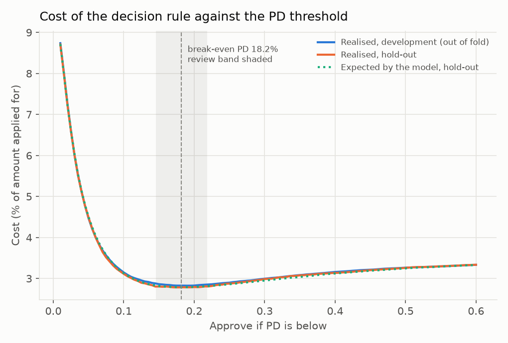

# Decision threshold

**Assumptions (config/decision.yaml, not real bank figures):** LGD 45% of the loan amount, margin lost on a declined good applicant 10% of the loan amount, manual review when the two expected costs are within 2% of the loan amount.

Approving costs PD x 0.45 x amount, and declining costs (1 - PD) x 0.10 x amount, so approving is cheaper when PD < 0.10 / (0.45 + 0.10) = **18.2%**. The review band is PD 14.5% to 21.8%.

Check against the data: on the development out-of-fold PDs the realised cost is lowest at a threshold of 19.0%, close to the break-even PD of 18.2%. The two agree because the PDs are calibrated: a miscalibrated model would need its threshold tuned by hand.

The cost curve is flat near its minimum: on the hold-out set it is 2.80% of the amount applied for at a threshold of 14.5%, 2.78% at 18.2% and 2.81% at 21.8%. So the exact threshold matters much less than having calibrated PDs, and the review band costs little.

## Decisions on the hold-out set

| Decision | Applicants | Share | Mean PD | Actual default rate |
|---|---|---|---|---|
| approve | 52,088 | 84.7% | 4.8% | 4.8% |
| review | 4,484 | 7.3% | 17.8% | 17.7% |
| decline | 4,931 | 8.0% | 33.7% | 34.0% |

With a single cut at the break-even PD (no review band) the approval rate is 89.0% and the default rate among approved applicants is 5.4%, against 8.1% for everyone. Realised cost: 2.78% of the amount applied for, against 3.40% if every applicant were approved.

## Sensitivity to the margin assumption

| Margin | Break-even PD | Approval rate (hold-out) | Default rate among approved |
|---|---|---|---|
| 5% | 10.0% | 75.4% | 3.9% |
| 10% | 18.2% | 89.0% | 5.4% |
| 15% | 25.0% | 93.8% | 6.2% |
| 20% | 30.8% | 96.1% | 6.7% |

A higher margin makes each declined good customer more costly, so the rule approves more applicants and accepts a higher default rate.
